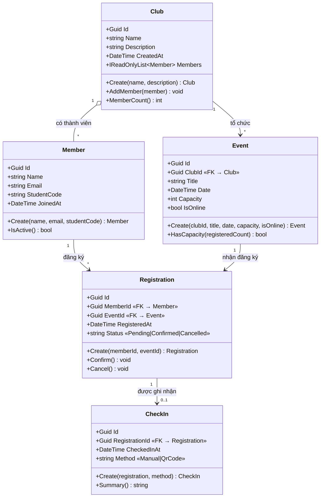

# Sơ đồ lớp sơ bộ — EduHub

Thuộc tính chính, khoá ngoại (FK) và bội số quan hệ. Vẽ bằng Mermaid.

## Ghi chú

- `Registration` là bảng nối quan hệ nhiều–nhiều giữa `Member` và `Event`.
- `CheckIn` quan hệ 1–1 với `Registration` (0..1: chưa check-in thì chưa có bản ghi), chỉ tạo được khi phiếu `Confirmed`.
- `Club.Members` chỉ đọc; thêm thành viên bắt buộc qua `AddMember` (chặn null và trùng).
- Mọi entity có constructor private + factory `Create(...)` để kiểm tra dữ liệu ngay khi tạo.
